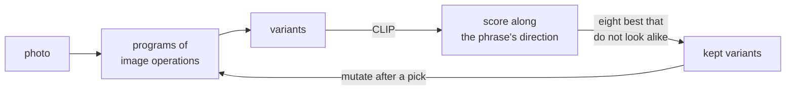

# imagevolve

[imagevolve](https://gustavecortal.com/imagevolve/) is a CLIP-guided evolutionary search over deterministic image transformations that bring your picture closer to your words. No diffusion model draws anything: CLIP only ranks the variants. The [live demo](https://gustavecortal.com/imagevolve/) runs in the browser, and this repository runs the same search from the command line.

<p align="center">
  <a href="https://gustavecortal.com/imagevolve/"></a>
</p>

## Quick start

With [Node.js](https://nodejs.org/) 24 or later:

```bash
git clone https://github.com/gustavecortal/imagevolve.git
cd imagevolve
npm install
node evolve.mjs docs/sample.jpg "a storm at sea"
```

The first run downloads the [CLIP model files](https://huggingface.co/gustavecortal/imagevolve-clip-vit-base-patch32) (156 MB) into `models/`. The search then tries 800 variants on the CPU, in under a minute on a desktop computer. It saves the eight it keeps to `out/`, as `1.jpg` to `8.jpg` with their programs in `1.json` to `8.json`.

To evolve a variant further, as a tap does on the web page, give its program and the same photograph:

```bash
node evolve.mjs docs/sample.jpg "a storm at sea" --keep out/3.json --out out2
```

Any JPEG, PNG or WebP works in place of `docs/sample.jpg`. `node evolve.mjs --help` lists the options, and `node test.mjs` checks that programs render deterministically.

## How it works



A variant is a program of up to six deterministic operations, such as tile shuffles, swirls or recolourings, each with its parameters, a strength and sometimes a soft mask. [CLIP](https://github.com/openai/CLIP) ViT-B/32 scores it by how far its image embedding moves from the original's along a text direction: from the embedding of "a photograph" to that of your words. The mean of such directions over 430 generic phrases is subtracted, so a change that raises every phrase's score does not count. A variant whose embedding stays within a cosine of 0.92 of the original's reads as the photograph unchanged and is dropped.

The search keeps the eight best variants, no two of them at a cosine above 0.92. Before a pick, it proposes random programs. After a pick, three proposals in four mutate the picked variant or the best variant that looks like it: a parameter changes, an operation is inserted, deleted or moved, or a few operations are spliced in from another variant, as a crossover does in genetic programming. Mutations can grow a program to eight operations.

| File | Contents |
|---|---|
| [`src/effects.mjs`](src/effects.mjs) | The 17 image operations and their soft masks |
| [`src/recipes.mjs`](src/recipes.mjs) | Random programs (recipes in the code) |
| [`src/search.mjs`](src/search.mjs) | Proposals, mutations and the choice of the eight kept variants |
| [`src/score.mjs`](src/score.mjs) | The text direction a variant is scored along |
| [`src/bank.txt`](src/bank.txt) | The 430 generic phrases |
| [`src/clip.mjs`](src/clip.mjs) | The pinned CLIP model and its embeddings with ONNX Runtime |
| [`evolve.mjs`](evolve.mjs) | The command-line search |

## Rebuild the model

The model is CLIP ViT-B/32 cut down for speed. The vision model reads 160-pixel input instead of 224 and computes in 8-bit integers. The text model stores its token table in 8 bits. Its scores follow those of the same model in float32 with a correlation of 0.998 at the median (80 transformed photographs, 3 phrases). With [uv](https://docs.astral.sh/uv/getting-started/installation/):

```bash
uv run export.py
```

`export.py` rebuilds the four model files from [Xenova's ONNX export of CLIP](https://huggingface.co/Xenova/clip-vit-base-patch32) into `export/`, and checks that they hold the same graphs and weights as the [files on Hugging Face](https://huggingface.co/gustavecortal/imagevolve-clip-vit-base-patch32). `node direction-bank.mjs` rebuilds `src/bank.json`, the mean direction of the generic phrases.

## License

The code is under the [MIT license](LICENSE), as is CLIP. The sample photograph is mine, under [CC BY 4.0](https://creativecommons.org/licenses/by/4.0/).
