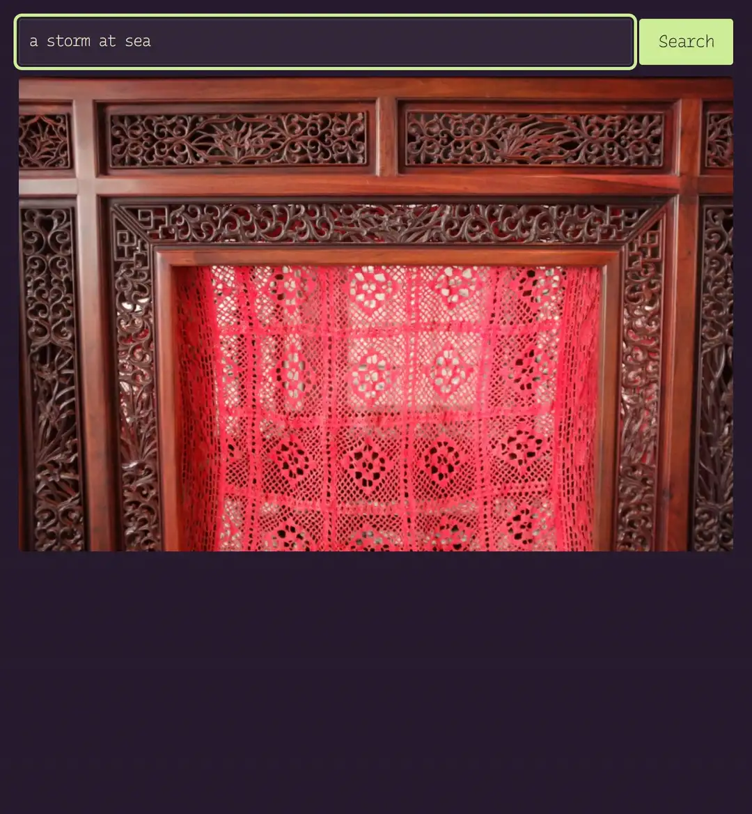

# imagevolve

[imagevolve](https://gustavecortal.com/imagevolve/) is a CLIP-guided evolutionary search over deterministic image transformations that bring your picture closer to your words.

<p align="center">
  <a href="https://gustavecortal.com/imagevolve/"></a>
</p>

## Quick start

With [Node.js](https://nodejs.org/) 24 or later:

```bash
git clone https://github.com/gustavecortal/imagevolve.git
cd imagevolve
npm install
node evolve.mjs docs/sample.jpg "a storm at sea"
```

The first run downloads [the model](https://huggingface.co/gustavecortal/imagevolve-clip-vit-base-patch32) (154 MB). The search then scores 800 variants on the CPU, which takes about a minute on a desktop processor, and saves the eight it keeps to `out/` as `1.jpg` to `8.jpg`, each with its program in `1.json` to `8.json`.

To breed from a variant you like, as tapping it on the web page does, run the search again from it:

```bash
node evolve.mjs docs/sample.jpg "a storm at sea" --keep out/3.json --out out2
```

`--proposals`, `--seed` and `--size` (the longest edge of the saved pictures, 2048 pixels by default) change the rest.

## How it works


A variant is a program of two to six deterministic operations, such as tile shuffles, swirls or recolourings, each with its parameters, a strength and sometimes a soft mask. [CLIP](https://github.com/openai/CLIP) ViT-B/32 scores it by how far its image embedding moves from the original's along a text direction: from the embedding of "a photograph" to that of your words, minus the mean of such directions over 430 generic phrases, so that changes every phrase rewards do not count. Nothing is optimized by gradient descent: CLIP only ranks the variants.

The search keeps the eight best variants that do not look alike, their image embeddings at a cosine below 0.92. Before you pick one, it proposes random programs. After a pick, three proposals in four mutate the picked variant or its best refinement: a parameter changes, an operation is inserted, deleted or moved, or a few operations are spliced in from another variant. Mutations can grow a program to eight operations.

| File | Contents |
|---|---|
| [`src/effects.mjs`](src/effects.mjs) | The 18 image operations and their soft masks |
| [`src/recipes.mjs`](src/recipes.mjs) | Random programs |
| [`src/search.mjs`](src/search.mjs) | Proposals, mutations and the choice of the eight kept variants |
| [`src/direction.mjs`](src/direction.mjs) | The text direction a variant is scored along |
| [`src/clip.mjs`](src/clip.mjs) | CLIP embeddings with ONNX Runtime |
| [`evolve.mjs`](evolve.mjs) | The command-line search |
| [`direction-bank.mjs`](direction-bank.mjs) | Rebuilds the mean direction of the 430 generic phrases |
| [`export.py`](export.py) | Rebuilds the model files from Xenova's ONNX export of CLIP |
| [`test.mjs`](test.mjs) | Checks that programs render deterministically |

## Rebuild the model

The model is CLIP ViT-B/32 cut down for speed. The vision model reads 160-pixel input instead of 224 and computes in 8-bit integers, and the text model stores its token table in 8 bits. Its scores follow those of the full-precision model at a correlation of 0.998. With [uv](https://docs.astral.sh/uv/getting-started/installation/):

```bash
uv run export.py
```

This writes the four model files to `export/` and checks that they hold the same graphs and weights as the files on the Hub.

## License

The code is under the [MIT license](LICENSE). CLIP is under the MIT license. The sample photograph is mine, under [CC BY 4.0](https://creativecommons.org/licenses/by/4.0/).
